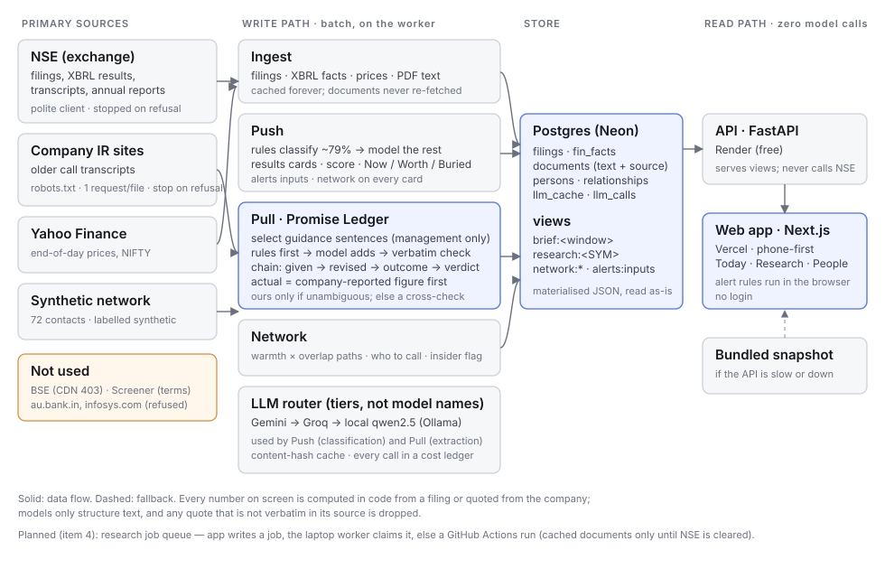

# FINN — an investor's agent for Indian listed companies

FINN reads what Indian listed companies file and say, and turns it into three things an investor
uses every day, on a phone:

- **Today (Push)** — every filing from your portfolio, ranked into *Now*, *Worth knowing* and
  *Buried*, with results cards, management-change cards and material-event cards; alerts on
  volume, price and filing type that you tune yourself.
- **Research (Pull)** — the **Promise Ledger**: what management guided on earnings calls, how
  the guidance moved, and what the company later delivered, with every quote and every number
  cited to its source.
- **People (Network)** — who in your (synthetic) network can help with a filing or a company,
  how warm the path is, and what to ask.

Built for the ENAM Holdings Founding AI Engineer build challenge.

**Live:** https://finn-tawny-nine.vercel.app (API: https://finn-api-mxni.onrender.com/health)

### Three things to try on your phone
1. **Research → KAYNES.** Eight earnings calls read. FY25 revenue guided above ₹3,000 cr, cut
   to ₹2,800–2,900 cr, delivered ₹2,722 cr (missed); FY26 growth guided "around 50%", the
   company reported 33% (missed); EBITDA margin beat both years. Tap any call for the
   management quote with page and link.
2. **Research → CREDITACC.** A lender's guidance chain: FY26 loan growth guided 18–20%, cut to
   14–18%, company-reported 14.0% (delivered); ROA and ROE missed on the company's own figures,
   with our figures from the filings shown beside them as a cross-check.
3. **Today**, window *30d*: the HDFC Bank MD & CEO change — bio from the company's own filing,
   and the note that you (the investor) overlapped with him at ICICI Bank.

## What makes it trustworthy
- **Primary sources only.** Exchange filings and XBRL results, earnings-call transcripts (NSE or
  the company's own investor-relations site), end-of-day prices. No news, no broker notes, no
  model knowledge.
- **Code computes, models only read.** Margins, growth, verdicts, rankings and link strengths are
  computed in code. Models only turn transcript sentences into structured claims, and a claim is
  dropped unless its quote appears verbatim in the transcript.
- **The company's own numbers decide.** When a company later reports the metric it guided, that
  reported figure is the actual (quoted, cited). Our own computation from the filings decides a
  verdict only where the filing is unambiguous (revenue, rupee revenue growth, EBITDA margin);
  everywhere else it is shown only as a cross-check, and a claim with no reliable actual is
  marked *not scored*.
- **Honest labels.** "Read 4 of 8 calls", "open · due FY31", "not scored", "synthetic" on every
  network contact, and the source of every transcript ("NSE", "company IR site").

## How it is built
Batch pipelines (laptop worker) read the sources, compute everything, and write materialised JSON
views to Postgres; the API serves those views as-is and the web app renders them, falling back to
a bundled snapshot when the API is slow. The read path makes no model calls. Details, the data
model, the LLM strategy and the full data-access history: **[docs/ARCHITECTURE.md](docs/ARCHITECTURE.md)**.



| Part | Stack | Hosted on |
|---|---|---|
| Web | Next.js 16, React 19, Tailwind 4 | Vercel (Hobby) |
| API | FastAPI, psycopg 3 | Render (free, Docker) |
| Database | Postgres 18 | Neon (free); local Docker for dev and tests |
| Models | OpenAI-compatible router: Gemini, Groq, local Ollama (qwen2.5 7B) | free tiers / laptop |
| CI | ruff, mypy, pytest; eslint, tsc, vitest, next build | GitHub Actions |

## Run it locally
```bash
docker compose up -d --wait                          # Postgres 18
cd api && python -m venv .venv && .venv/Scripts/pip install -e ".[dev]"   # bin/ on macOS/Linux
cp ../.env.example ../.env                           # every value has a local default
.venv/Scripts/finn migrate
.venv/Scripts/finn ingest all                        # filings, XBRL, prices, transcripts (polite, cached)
.venv/Scripts/finn push                              # classify → cards → network → alerts → briefs
.venv/Scripts/finn research KAYNES,CREDITACC --offline   # Promise Ledger from cached documents
.venv/Scripts/uvicorn finn.api.main:app --port 8000
cd ../web && npm install && npm run dev              # http://localhost:3000
```
Models: with no keys set, everything runs on a local Ollama model
(`ollama create qwen2.5-7b-8k -f ops/Modelfile.qwen2.5-7b-8k`). Add `GEMINI_API_KEY` /
`GROQ_API_KEY` to `.env` and the router uses them first; providers without a key are skipped.

Other commands: `finn network [--seed]` (synthetic network + views), `finn import-transcripts SYM`
(transcripts from `data/ir/<SYM>/` or `data/manual/<SYM>/`), `finn export-snapshot` (bundle
views into the web app), `finn counts`.

Checks: `cd api && ruff check . && mypy finn && pytest -q` · `cd web && npm run lint && npx next typegen && npx tsc --noEmit && npm test && npm run build`.

## Repository map
```
api/finn/sources/   NSE client (polite, stops on refusal), company-IR fetcher, PDF text, prices
api/finn/fin/       XBRL parser (numeric spine: every fact stored as reported)
api/finn/push/      rules + model classification, results cards, scoring, briefs, alerts
api/finn/pull/      transcripts, guidance extraction, reported outcomes, ledger, research views
api/finn/network/   people from filings, synthetic network, paths, who-to-call
api/finn/llm/       tier router (fallback, throttling, cache, cost ledger)
api/finn/api/       FastAPI read endpoints (views only)
web/                Next.js app; web/public/snapshot = bundled fallback views
data/               portfolio, research set, labelled eval sets, IR/manual transcript manifests
docs/               SPEC, ARCHITECTURE, DECISIONS (every decision, dated), PHASES (gate evidence),
                    evals, STATUS (scope vs spec)
scripts/            portfolio picker; Neon-over-HTTPS mirror for networks that block port 5432
```

## Status
Scope against the spec is tracked item by item in [docs/STATUS.md](docs/STATUS.md); gate evidence
per phase in [docs/PHASES.md](docs/PHASES.md); model choices and their measurements in
[docs/evals.md](docs/evals.md). Not built yet: live research from the phone (job queue), the Ask
bar, balance-sheet / cash-quality / red-flag research sections, the cost-ledger screen.

## Data use
Exchange data is used for a personal, non-commercial evaluation prototype, at minimal footprint
(one request at a time, cached, never re-fetched, demo companies only), with every document linked
back to its source and never re-hosted. A production deployment would use a licensed data feed.
See [docs/ARCHITECTURE.md § Data access](docs/ARCHITECTURE.md#data-access-what-actually-happened).
