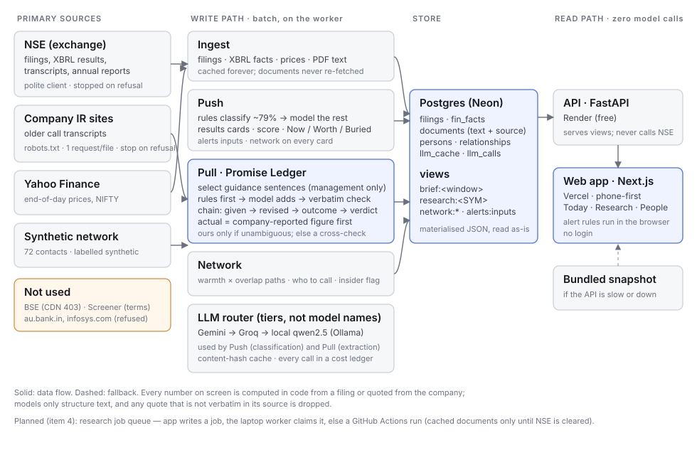

# FINN — architecture

FINN is two halves joined by one table:

- a **write path** — batch pipelines on a worker (today: the owner's laptop) that read primary
  sources, compute everything, and write materialised JSON **views** to Postgres;
- a **read path** — a FastAPI service that returns those views as stored, and a Next.js phone app
  that renders them, falling back to a snapshot bundled into the app when the API is slow or down.

The read path never calls a model and never calls an exchange. Everything a user sees was computed
before they asked, so the app is fast, cheap, and still works when a source or a model is down.

## 1. Components

| Component | Where | What it does |
|---|---|---|
| `finn/sources/http.py` | worker | Polite client for NSE: one request at a time ≥ 1.2 s apart, disk cache by URL (documents forever), one retry only for timeouts/5xx; any 401/403/429 or "access denied" page writes `data/cache/SOURCE_REFUSED.json` and blocks every later request until a person reviews it. |
| `finn/sources/ir.py` | worker | Company investor-relations sites: robots.txt first and obeyed, one plain request per file ≥ 5 s apart, cached in `data/ir/<SYM>/`, and the first refusal writes `IR_REFUSED_<host>.json` — that host is never contacted again. |
| `finn/fin/xbrl.py` | worker | Parses NSE XBRL results into `fin_facts` (concept, dimensions, period, value as reported). The numeric spine for every card and every actual. |
| `finn/push/` | worker | Classifies filings (rules, then a model for the remainder), builds results cards from XBRL, scores and tiers items, attaches the network, materialises `brief:<window>` and `alerts:inputs`. |
| `finn/pull/` | worker | The Promise Ledger: transcript selection, guidance extraction, reported-outcome reading, chains and verdicts, `research:<SYM>` views. |
| `finn/network/` | worker | People named in filings (verified against the filing text), the synthetic network, warmth and path scores, who-to-call with an insider flag, `network:*` views. |
| `finn/llm/router.py` | worker | Tiers (`BULK`, `EXTRACT`, `REASON`) mapped to ordered `provider:model` lists from env; per-model throttling; on 429/5xx waits and retries once, then falls to the next provider; strict JSON schema with one repair retry; content-hash cache; every call logged to `llm_calls`. |
| `finn/api/main.py` | Render | Read-only endpoints over `views`: `/api/brief`, `/api/research/{SYM}`, `/api/network/...`, `/api/alerts/inputs`, `/health`. |
| `web/` | Vercel | Today, Research and People tabs. `loadWithFallback` tries the API, then `public/snapshot/*.json`. Alert rules are evaluated in the browser by the same pure function the API tests use (shared fixture). |

## 2. Data model (the parts that matter)
- `filings`, `filing_class` — every announcement with its NSE link; category, score, how it was
  decided (rules / model).
- `fin_filings`, `fin_facts` — XBRL filings and every fact as reported (consolidated preferred per
  period; the basis is stored, never silently spliced).
- `documents` — transcripts and annual reports: page text, `source` (`NSE`, `company IR site`, or
  `company IR site, downloaded by hand`) and the **original URL** for the citation.
- `persons`, `employments`, `relationships`, `meetings` — the network (synthetic contacts are
  flagged and labelled in the UI).
- `llm_cache`, `llm_calls` — content-addressed model answers; a ledger of every call (provider,
  model, tokens, latency, cache hit).
- `views(key, body, as_of)` — the only thing the read path touches.

## 3. The Promise Ledger (pull)
For each company: the last 8 earnings calls (one per quarter; a copy with text beats one without).

1. **Select.** Split each transcript into sentences across page breaks (running headers removed),
   attribute speakers (analysts are the names the moderator introduces; their lines and the
   moderator's never count), keep management sentences with a guidance cue and a number.
2. **Extract — rules first.** Each metric keyword takes its own number (`"AUM growth of 20–25%,
   NIM of 12.8–13.2%"` → two claims; `"4.2%-4.5% ROA"` → number before the word). A sentence that
   continues a guidance sentence counts too. Skip patterns remove questions, analyst paraphrases,
   results, increments ("additional 40–50 bps"), run rates, assumptions ("with a 14.5% NIM, we
   can…"), ratios ("working capital to revenue"), and segment or subsidiary figures.
3. **Extract — model adds.** The `EXTRACT` tier reads the same sentences and adds what rules
   can't (scope, a number with no keyword next to it). A model item is kept only if its quote is
   verbatim in the transcript, it passes a strict check (management, forward-looking, high
   confidence, metric named in its own quote, the band's numbers present in the quote), and it
   doesn't conflict with a rule item from the same sentence.
4. **Periods: the quote must name the year.** A claim is held to a year only if its own quote (or
   the continuation sentence quoted with it) names it ("FY26", "this year", "the financial year");
   otherwise it is listed as *no year stated* and never scored. `"FY25-26"` = FY26; multi-year
   targets, CAGRs and long-term bands are *open-ended*. Achievements, figures that "stand at",
   share-of-revenue targets and restated old goals are never guidance.
5. **Chains.** Points per (metric, year) across calls; *raised / cut / held* computed by comparing
   bands, not by reading adjectives. Management's own qualifier is kept ("preliminary outlook").
   A **verbal steer** (an analyst states a range, management's reply explicitly confirms or rejects
   it) is attached with both lines quoted and no invented number. Chains stated in the same
   sentences (e.g. AUM growth, ROA and ROE) are shown as one timeline.
6. **Actuals — the company's own figure first.** `finn/pull/reported.py` reads, from later calls,
   management sentences that state a result for a tracked metric and a period: the period marker
   nearest the number decides (*"for FY26"*, *"for the year"* in a Q4 call, *"H1"* in a Q2 call —
   a quarter marker means it is not the year's figure), and the number must sit right after its
   metric word. That figure is the actual, quoted with page and link, labelled *company-reported*.
   Our own figure from the XBRL filings is the actual **only where the filing is unambiguous**
   (revenue, rupee revenue growth, EBITDA margin); for ROA, ROE, loan growth, credit cost, NIM,
   operating margin and capex it is shown beside the company's as a cross-check and never decides.
   No reliable actual → *not scored*; the year still running → *open*. Constant-currency guidance
   is only ever compared with a constant-currency figure the company reported.
7. **Two verdicts.** Code compares the actual with the **first** guidance for that year and with the
   **last** before the result: "Missed preliminary 18–20% outlook · met the lowered 14–18%, at the
   very bottom of the range". *Beat* = clearly above the band; *delivered* = within it or meeting a
   floor; a promise met only after a cut is labelled so, never a plain "delivered". Guided and
   actual more than 30% apart → *not scored* unless the quote names that exact year. The ledger
   line counts both ("none met as first given · 1 met only after a cut · 4 missed, 2 of them even
   after a cut"); the say–do line needs ≥ 4 resolved claims.

Nothing in this pipeline is per-company: the same vocabulary, rules and checks run for every
ticker, and every rule that exists was added because a reviewed claim on some company was wrong
(the list is in `docs/DECISIONS.md` and pinned by tests in `api/tests/test_pull.py`).

## 4. LLM strategy
- **Rules first, everywhere.** 947 of 1,196 filings (79%) are classified by rules with no model
  call; guidance rules alone reach precision 1.00 / recall 0.75 on the hand-listed gold set.
- **Chosen by measurement.** Free-tier limits were measured, not assumed (Groq 8k tokens/min;
  Gemini 3.5-flash-lite 15/min; Gemini 3-flash 5/min and often unavailable; Gemini Pro not on the
  free tier). Extraction models were compared on a hand-listed gold set (docs/evals.md); the
  `EXTRACT` tier is Gemini 3.5-flash-lite → Groq gpt-oss-120b → Gemini 3-flash → local qwen2.5.
- **Read once.** Answers are cached by `sha256(tier + prompt version + input)`; a transcript is
  never sent twice. Ledger at the time of writing: Gemini 602 calls (433 cache hits), local qwen 324 (107), Groq
  33 (26).
- **Keyless by default.** With no keys the whole system runs on a local Ollama model.

## 5. Data access: what actually happened
The brief points candidates to exchange filings. We tried each candidate source, followed each
one's rules, and stopped wherever we were refused. Every step is dated in `docs/DECISIONS.md`.

**BSE — dropped (12 Nov).** BSE's announcements API and scrip list returned *403 Access Denied*
from a CDN. Getting past it would have meant imitating a browser session — bot-check
circumvention — so we didn't, and BSE was dropped as a source.

**Screener — never scraped (12 Nov).** Its terms licence "personal, non-commercial transitory
viewing only" and forbid copying or public display. FINN needs to store tables and show them, so
the terms rule it out regardless of robots.txt.

**NSE — the single source, under written rules (12 Nov).** NSE answered plain requests without
cookies: announcements, XBRL results (2018 →), transcripts, annual reports. Because NSE's terms
also restrict automated collection, the owner set mandatory rules, enforced in code where
possible: never work around a block, bot check or rate limit; one request at a time, ≥ 1 s apart;
cache everything and never re-fetch a document; fetch only demo companies and requested tickers;
never re-host PDFs (store text, link to NSE); credit NSE in the UI.

**Datacentres — the server never calls NSE.** A probe from Render (Singapore) got *403*; a
GitHub-hosted runner got *200*. So ingestion runs on the worker, and the hosted API only serves
views.

**NSE refused the laptop (13 Nov, 03:05 IST).** After ~900 successful responses on 12 Nov, the
first request of a new run — a transcript on the same host and path as 24 that had worked — got
Akamai's *Access Denied*. There had been no NSE request for 3 h 03 min, and nothing else in that
run. The client stopped, wrote `SOURCE_REFUSED.json`, and nothing has called NSE since. Later
that day infosys.com (also on Akamai) refused a single plain request from the same network, which
points at the network rather than our request rate. The owner is checking the URL in a browser; NSE stays stopped until then,
including from GitHub.

**Fallback: the companies' own investor-relations sites.** Companies publish the same transcripts
themselves. With the owner's approval FINN fetched from them under stricter rules: robots.txt read
first and obeyed, one plain request per file (honest User-Agent, no header tricks, no retries),
≥ 5 s apart, cached, and a permanent stop for a host on its first refusal. Listing pages that
build their links with JavaScript were not driven; URLs came from web search, with at most three
naming variants tried per file.

| Site | Outcome |
|---|---|
| creditaccessgrameen.in | 4 transcripts |
| kaynestechnology.co.in | 4 transcripts |
| persistent.com | 3 transcripts (1 not findable) |
| investors.larsentoubro.com | 5 transcripts (3 not findable) |
| **au.bank.in** | **403 on the first page — stopped; never contacted again** |
| **infosys.com** | **403 Access Denied — stopped; never contacted again** |
| godeepak.com | TLS certificate fails verification — skipped (we don't disable verification) |

Each transcript records where it came from (`NSE` / `company IR site` / `downloaded by hand` for
files the owner places in `data/manual/`), and the citation links to that original URL.

**What the refusal was.** On 13 Nov the exact URL NSE had refused was requested once more from a
phone hotspot with the same client: HTTP 200, the PDF. The refusals came from the campus network's
address, not the client. NSE fetching resumed from the laptop on the hotspot only, and NSE also
serves GitHub Actions runners, which run live research jobs.

**The database over port 443.** The same network resets Postgres connections on port 5432 (TLS
reset even with direct TLS). Neon's HTTPS SQL endpoint works, so `scripts/neon_http.py` mirrors
the tables to a local Postgres for the pipelines and writes results back. Write-back is
allowlisted so it can never overwrite what the live app writes: views only under pipeline-owned
prefixes, the model cache insert-only, the call ledger appended without ids, documents inserted by
URL without touching existing text; any other table is refused, and the target is read only from
`.env` and must be a Neon host. Its first run hit a duplicate key and failed rather than overwrite.

## 6. Security and privacy
- No secrets in the repo: `.env` is ignored; hosted secrets live in Render/Vercel settings.
- The network is synthetic and labelled so; contacts who currently work at a company carry an
  insider warning ("don't seek unpublished price-sensitive information").
- Free model tiers may use prompts for training: acceptable here because filings are public and
  the network is synthetic. In production, personal data would go only to a paid, no-training
  endpoint.
- No login in the prototype (single investor). Per-viewer settings (alert rules) stay in the
  browser.

## 7. Quality
- **Tests:** 85 API tests (classification rules, text-based severity, grounding of model-written
  lines, XBRL quirks, router fallback, job queue and limits, network scoring and filing-bio spans,
  guidance rules and the live-run regression cases, reported outcomes, two-verdict chains, verbal
  steers) and 14 web tests (including the alert evaluator on a fixture shared with Python and the
  "who knows" search). `bash scripts/verify.sh` runs all of it plus the production build and a
  tracked-secrets check; CI runs the same on every push.
- **Evals** (docs/evals.md): classifier on 124 labelled filings (rules 85/85; 13 of 14 ranking
  regressions inside their expected range); guidance extraction on 26 hand-listed claims and 25
  negatives over 8 transcripts (shipped pipeline: precision 23/23 on claims held to a year,
  recall 0.88, negatives 25/25).
- **Review over volume:** every resolved claim on every reviewed ledger was read against its quote;
  wrong ones were removed by adding a general rule (and a regression test), never by special-casing
  a company. The first unreviewed live report (POLYCAB) produced four wrong verdicts; the rules
  that caught them now apply to every ledger, and live reports carry "not reviewed".

## 8. Live research for any ticker
The app writes a job (`POST /api/research/jobs`): the symbol is checked against NSE's list, a cached
report is returned as-is, one job runs per symbol, at most two at a time, with per-connection and
per-day limits. The owner's laptop worker claims it if online; otherwise the API starts a GitHub
Actions run for that job id. Each step reports progress, and runner start-up is shown as measured.
A refusal from NSE is recorded permanently for that origin. Gate: POLYCAB, never researched,
requested with the laptop offline, report in 2 min 46 s.

## 9. Known limits
- Some guided metrics can't be scored without the company's own figure; they show as *not scored*,
  with our estimate as a cross-check. Three extraction misses are documented in docs/evals.md.
- Six filings are "Not read yet" (their text needs a fetch from a network NSE accepts).
- Balance sheet, cash quality and red-flag research sections are deliberately not built;
  notifications are in-app only (no web push yet). See docs/STATUS.md and docs/HANDOFF.md.
